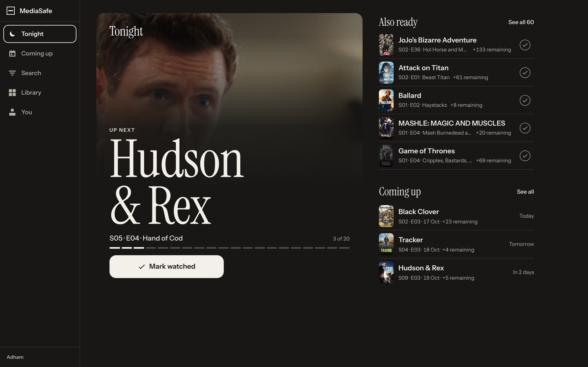
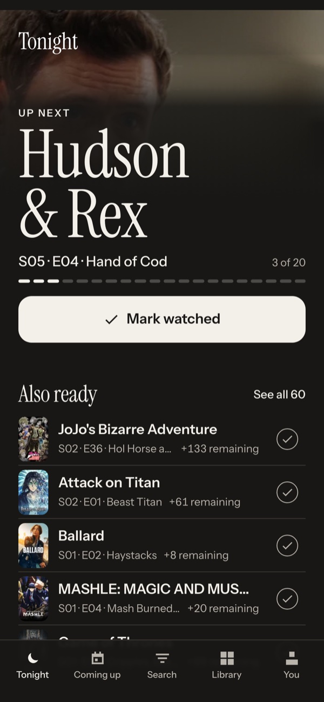
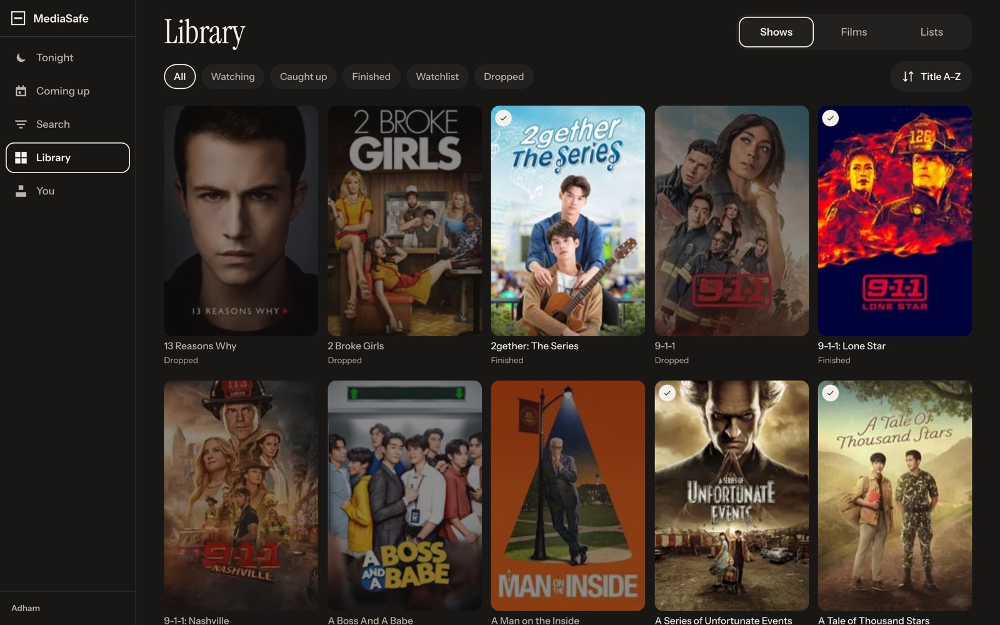
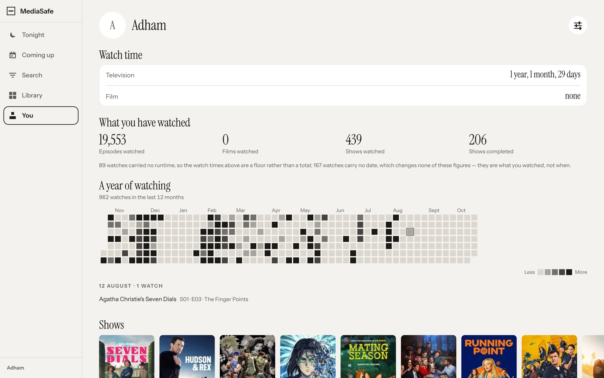
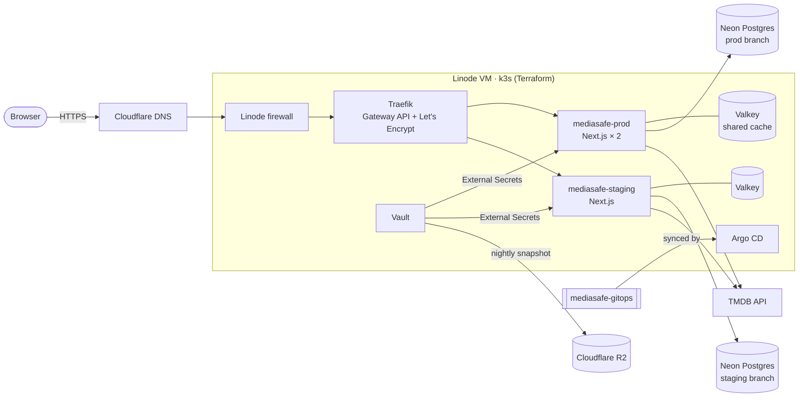
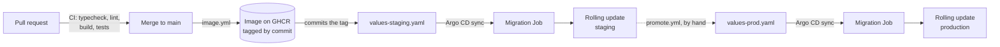

# MediaSafe

**A personal tracker for the shows and films I watch — built, deployed and operated end to end
by one person.** Live at **[mediasafe.space](https://mediasafe.space)**, running on a k3s
cluster I provision with Terraform and deploy with Argo CD.

[](https://mediasafe.space)
[](https://staging.mediasafe.space)


<p align="center">
  
  
</p>

> **Status: actively developed and deployed.** Every merge to `main` ships to staging
> automatically; production is promoted by hand. ~700 commits, 170+ merged pull requests and
> 130 test files since August 2026. The library in these screenshots is my real one —
> 460 shows and ~19,500 watched episodes carried over from the previous version of this app.

You can sign in at [mediasafe.space](https://mediasafe.space) with any Google account; a new
account starts empty and can add titles from search.

---

## What it does

- **Tonight** — opens on the one episode you are most likely to watch next, over its artwork,
  with every other show that has an unwatched episode ready beneath it. Mark it watched with a
  tap, a swipe, or by painting down an episode list; every mark can be undone.
- **Coming up** — what airs next across your library, by day, in your own time zone. Also
  published as a private **iCalendar feed** you can subscribe to from any calendar app.
- **Library** — shows, films and your own lists, filtered by where each one stands
  (watching, caught up, finished, watchlist, dropped).
- **You** — total watch time, counts, and a year-long activity heatmap.
- **Search and import** — add anything from [TMDB](https://www.themoviedb.org/)'s catalogue,
  or bring a whole history across in one import.
- **Kept fresh overnight** — a nightly job re-reads up to 200 titles from TMDB, so new
  seasons and air dates appear without anyone asking.
- Works as an installable app on a phone, in light and dark.

<p align="center">
  
  
</p>

## How it works



**The app.** Next.js 16 (App Router, React Server Components, server actions) with TypeScript,
Tailwind and Motion. Data lives in Postgres on [Neon](https://neon.tech), accessed through
Drizzle ORM; sign-in is Google OAuth through [Better Auth](https://www.better-auth.com). Server
renders are cached in Valkey through a custom Next.js cache handler shared by every replica, so a
write on one pod invalidates the cache for all of them. Errors go to Sentry.

**The infrastructure.** One Linode VM running k3s, created by Terraform along with its
firewall, a block volume, the DNS records and the R2 buckets
([`infra/terraform`](infra/terraform)). Everything *inside* the cluster is declared in a second
repository, **[mediasafe-gitops](https://github.com/Joyaroin/mediasafe-gitops)**, which Argo CD
keeps the cluster in sync with: Traefik behind the Kubernetes Gateway API, cert-manager for TLS,
HashiCorp Vault for secrets (configured by Terraform in [`infra/vault`](infra/vault)) with
External Secrets copying them into each namespace, and a Helm chart for the app itself, with one
values file per environment. Why this shape, and what it replaced, is in
[ADR 0001](docs/adr/0001-deploy-to-k3s-on-linode-with-gitops.md).

### How a change reaches production



1. CI runs on every pull request: typecheck, ESLint (including this repo's own rules), a
   production build, and the suites that need no database.
2. A merge to `main` builds a container image tagged with the commit SHA, pushes it to GHCR,
   and commits that tag to the gitops repo's staging values.
3. Argo CD notices the commit, runs pending database migrations as a Job **before** any new pod
   starts, then rolls the pods over with zero unavailable. A failed migration fails the sync and
   the old pods keep serving.
4. Production gets exactly the image staging already ran, via a one-click `promote.yml` workflow.

Git is the only way the cluster changes: Argo CD reverts hand edits and prunes anything removed
from the repo, and no secret is ever in git.

## Engineering decisions worth a look

- **A failed read can never look like an empty one.** A library that fails to load must not
  render as "you have no titles". No `catch` may return `[]`, and that is enforced by a custom
  ESLint rule ([`eslint-rules/no-empty-catch.mjs`](eslint-rules/no-empty-catch.mjs)), not by
  review. Errors are shown by blast radius: an inline panel for a region that failed to load, a
  toast that never auto-dismisses for a lost write, a full page for a failed sign-in, a banner
  when the app is offline. Every one carries the Sentry event id as its reference.
- **Derived state lives in the database.** Where a show stands and which episode is next are
  answered by Postgres views ([`db/views.ts`](db/views.ts)), so every screen agrees.
- **Migrations are safe by construction.** Forward-only and expand-contract (a column is never
  dropped in the change that stops using it); a pending run applies in one transaction, so a
  migration that fails halfway applies nothing; and [squawk](https://squawkhq.com) lints the SQL
  for destructive operations.
- **The design system is tested.** Contrast ratios, corner radii and accent usage are asserted
  in Vitest, so a redesign can't quietly regress them.
- **Real infrastructure, kept small.** About $25/month: single node, Vault with a nightly
  Raft snapshot to R2 and a restore drill that has been run, secrets pulled from a password
  manager at the moment Terraform needs them and never written to disk.
- **Nothing was lost moving off the old app.** The previous tracker's database was archived,
  redacted (emails and password hashes removed, verified by checksum) and converted through the
  same import code users run ([`fixtures/README.md`](fixtures/README.md)).

## Running it locally

Needs Node 22+ and Docker.

```bash
npm install
./scripts/provision.sh   # interactive: writes the .env file the app needs
npm run db:up            # Postgres, a Neon-style WebSocket proxy and Valkey, then migrations
npm run dev              # http://localhost:3000
```

Local development uses the same database driver as production: the WebSocket proxy in
[`docker-compose.yml`](docker-compose.yml) lets Neon's serverless driver talk to a plain local
Postgres, so there is one data path everywhere.

```bash
npm run typecheck && npm run lint
DOTENV_CONFIG_PATH=.env.development.local npx vitest run   # full suite, against local Postgres
npm run test:e2e                                           # Playwright, local only
```

## Repository layout

| Path | What's there |
| --- | --- |
| `app/` | The Next.js app: routes, server actions, and `globals.css`, the design-token layer |
| `db/` | Schema (`tables.ts`, `views.ts`), the one driver, the data-access layer, the migration runner |
| `drizzle/` | Generated migrations, committed as plain SQL |
| `errors/` | The four failure surfaces and the Sentry reference id |
| `tmdb/`, `import/`, `cache/` | The TMDB client and mirror, the import format, the shared cache and its tags |
| `eslint-rules/` | Custom lint rules that make this repo's constraints mechanical |
| `tests/` | Vitest against a real Postgres; `tests/e2e/` is Playwright |
| `infra/terraform/` | The VM, firewall, volume, DNS and R2 buckets |
| `infra/vault/` | Vault's mounts, policies and auth (Kubernetes service accounts, Google sign-in) |
| `docs/` | The ADR, the infrastructure runbook, and the redesign spec |
| `fixtures/` | The redacted archive of the previous app's database |

Work is planned as GitHub issues: each feature is a `Spec:` issue split into sub-issues with
acceptance criteria and dependencies.
